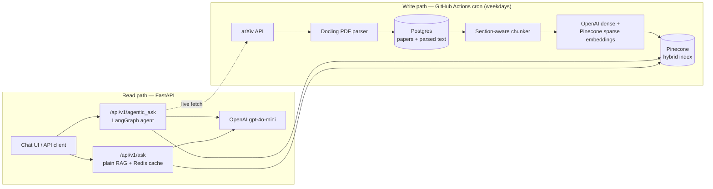
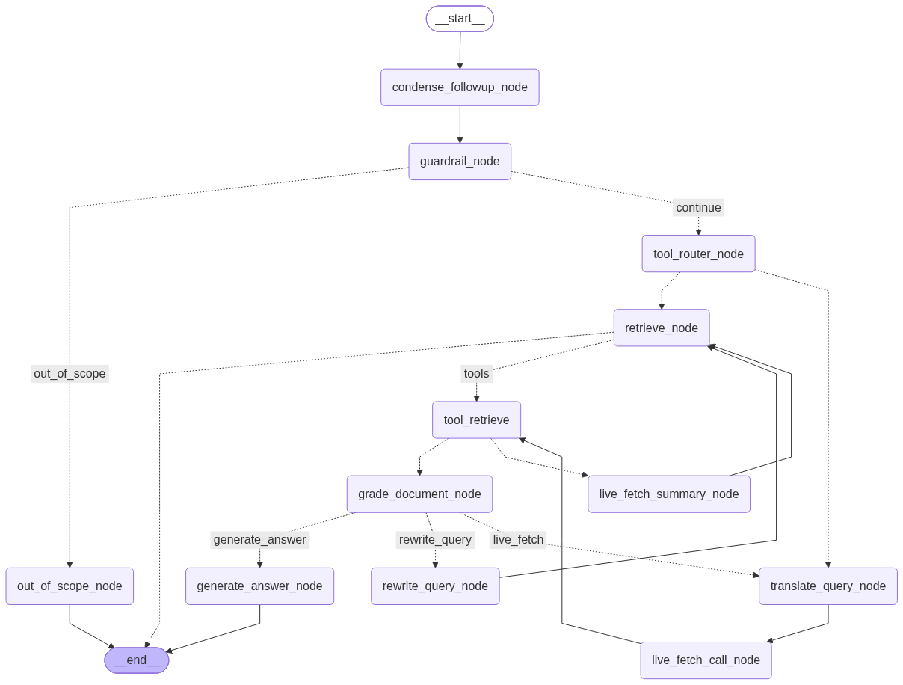

# PaperPilot

*Agentic research assistant for arXiv papers.*

An end-to-end RAG system for arXiv papers. A scheduled GitHub Actions job ingests new papers daily (arXiv API → Docling PDF parsing → Postgres → section-aware chunking → Pinecone hybrid index). A FastAPI service answers questions through a LangGraph agent with guardrails, document grading, a query-rewrite retry loop, Postgres-checkpointed conversational memory, and a live arXiv fetch tool. The agent calls that tool when the user asks for new papers, and it also falls back to it on its own when the indexed corpus can't answer a question. Traced with LangSmith. Quality is measured with a DeepEval suite (5 LLM-as-judge metrics over a synthetic golden set), which was also used to validate the migration from OpenSearch to Pinecone. See [Evaluation](#evaluation).

Built as a hands-on learning project, closely following the [`jamwithai/production-agentic-rag-course`](https://github.com/jamwithai/production-agentic-rag-course) curriculum, then simplified for cheap deployment (see [Deviations from the course](#deviations-from-the-course)).

---

## Architecture



**Write path.** [`scripts/ingest_papers.py`](scripts/ingest_papers.py) runs on a GitHub Actions cron ([`.github/workflows/ingest.yml`](.github/workflows/ingest.yml), 06:00 UTC on weekdays). It fetches the newest papers, parses them with Docling, upserts them into Postgres, and indexes them into Pinecone. Re-runs are idempotent.

**Read path.** One FastAPI process serves the API (`/api/v1/health`, `/api/v1/ask`, `/api/v1/agentic_ask`, `/api/v1/feedback`) and the chat UI at `/`. Redis caches `/ask` responses (and the API keeps working if Redis is down). LangSmith traces every LLM call in the agent, and `/feedback` attaches 👍/👎 ratings to those traces.

### The agent



The graph is checkpointed in Postgres per `thread_id`, so it remembers earlier turns of a conversation. Each question goes through four stages:

1. **Understand.** Follow-ups are condensed into a standalone question. A guardrail LLM scores the question's relevance, and off-topic questions are declined.
2. **Decide.** A tool router picks between *retrieve* (answer from indexed papers) and *fetch* (the user explicitly asked for new papers from arXiv).
3. **Get papers.**
   - The retrieve → grade → rewrite loop searches Pinecone. An LLM grades the results, and if they aren't relevant the query is rewritten and the search runs again.
   - **Fallback to live fetch.** If the results still fail grading after a rewrite, the corpus probably doesn't have the answer. The agent then translates the question into an arXiv query, downloads, parses and indexes the new papers, and searches again. A flag allows at most one fetch per question.
4. **Answer** from the graded chunks, with citations.

Tool calls are built in code; the LLMs make decisions at fixed checkpoints (scope, tool choice, relevance, query rewriting). This is a graph-based *workflow* rather than a free-running ReAct loop, so the guardrail always runs, retries are capped, and each decision can be evaluated on its own.

**Two PDF parsers.** Nightly ingestion uses Docling, which is slow but recovers section structure. The live-fetch path inside the API uses **pypdfium2** instead: plain text extraction with no ML models, about 0.5s for a 13-page paper. That keeps the API light and live fetches fast. Live-fetched papers have no section structure, so the chunker uses its 600-word sliding-window fallback for them.

---

## Status

| Layer | Status |
|---|---|
| Config, schemas, exceptions | ✅ |
| Postgres + SQLAlchemy ORM + Repository pattern | ✅ |
| arXiv API client (rate-limited, async) | ✅ |
| PDF parsing: Docling (ingestion) + pypdfium2 (live fetch) behind one `PDFParserService` | ✅ |
| `MetadataFetcher` orchestrator (async fan-out) | ✅ |
| Section-aware text chunker | ✅ |
| OpenAI embeddings client (auto-batched, async) | ✅ |
| **Pinecone hybrid retrieval** (dense OpenAI + normalized sparse vectors, α = 0.6) | ✅ |
| OpenAI LLM client + RAG prompt builder | ✅ |
| FastAPI app: lifespan, dependencies, middleware, OpenAPI | ✅ |
| `/api/v1/health` (Postgres + Pinecone status) | ✅ |
| `/api/v1/ask`: plain RAG with Redis exact-match cache | ✅ |
| **Agentic RAG** (LangGraph: condense, guardrail, tool router, retrieve, grade, rewrite, live fetch, generate) | ✅ |
| **Live-fetch fallback** when grading fails after a rewrite | ✅ |
| **Postgres-checkpointed conversational memory** (`AsyncPostgresSaver`, per `thread_id`) | ✅ |
| **LangSmith tracing** + `/api/v1/feedback` (👍/👎 on traces) | ✅ |
| **Chat UI**: conversation sidebar, agent trace panel, citation cards | ✅ |
| **Eval suite**: DeepEval goldens + 5 LLM-as-judge metrics | ✅ |
| **Daily ingestion on GitHub Actions** (replaced Airflow) | ✅ |
| **OpenSearch removed** (replaced by Pinecone; last version tagged `opensearch-baseline`) | ✅ |
| Agent-level evals (routing, grading, fallback paths) | ⏳ next |
| Hosted deployment of the API | 🗓️ planned |

---

## Tech stack

| Layer | Choice |
|---|---|
| Language | Python 3.12 (`uv` for dependency management) |
| API | FastAPI (lifespan + typed `Annotated[T, Depends(...)]` DI) |
| Scheduled ingestion | GitHub Actions cron, with the Docling model cache persisted between runs |
| Database | PostgreSQL 16 locally, Supabase (hosted Postgres) in production (SQLAlchemy 2.0 ORM) |
| Search | Pinecone serverless: dense OpenAI vectors + `pinecone-sparse-english-v0`, `dotproduct` metric, α-weighted hybrid |
| PDF parsing | [Docling](https://github.com/DS4SD/docling) for ingestion, [pypdfium2](https://github.com/pypdfium2-team/pypdfium2) for live fetch |
| Embeddings | OpenAI `text-embedding-3-small` (1024 dims via Matryoshka truncation) |
| LLM | OpenAI `gpt-4o-mini` (chat completion + structured Pydantic outputs) |
| Agent framework | LangGraph (StateGraph, Context DI, ToolNode, conditional edges; 2 tools: retrieve + live fetch) |
| Conversational memory | `AsyncPostgresSaver` (LangGraph's Postgres checkpointer), keyed by `thread_id` |
| Tracing | LangSmith (auto-instruments every LangGraph node + LLM call) |
| Evaluation | DeepEval (Synthesizer for goldens, LLM-as-judge metrics) |
| Cache | Redis 7 (exact match on the normalized query, 6h TTL) |
| Chat UI | Vanilla HTML/CSS/JS (`src/static/`, served via `StaticFiles`), no framework, no build step |
| Linting | Ruff (I, F, E, W, B, RET, SIM, UP) |

---

## Quick start

### Prerequisites

- Docker Desktop
- `uv` ([install](https://docs.astral.sh/uv/getting-started/installation/))
- An OpenAI API key and a Pinecone API key

### Setup

```bash
# 1. Install Python dependencies
uv sync

# 2. Create .env with your secrets
#   OPENAI_API_KEY=sk-...
#   PINECONE_API_KEY=...
#   LANGCHAIN_TRACING_V2=true          # optional: LangSmith tracing
#   LANGCHAIN_API_KEY=lsv2_pt_...
#   LANGCHAIN_PROJECT=paperpilot

# 3. Start local infra (Postgres + Redis; Pinecone is hosted)
make dev

# 4. Run the API with hot reload
make api                                # http://localhost:8000

# Or run everything (Postgres + Redis + API) in Docker
make start
```

### Ingest papers

```bash
uv run python -m scripts.ingest_papers           # same script the GitHub Actions cron runs
uv run python -m scripts.reindex_from_postgres   # rebuild the Pinecone index from papers already in Postgres
```

### Hit the API

```bash
# Health check (Postgres + Pinecone)
curl http://localhost:8000/api/v1/health

# Plain RAG Q&A (first call hits the LLM, a repeat call is served from Redis)
curl -X POST http://localhost:8000/api/v1/ask \
  -H 'Content-Type: application/json' \
  -d '{"query": "what is multi-head attention?"}'

# Agentic Q&A (thread_id is required: the graph is checkpointed per conversation)
curl -X POST http://localhost:8000/api/v1/agentic_ask \
  -H 'Content-Type: application/json' \
  -d '{"query": "how does BERT differ from GPT?", "thread_id": "demo-1"}'

# Follow-up in the SAME thread: condensed against earlier turns before retrieval
curl -X POST http://localhost:8000/api/v1/agentic_ask \
  -H 'Content-Type: application/json' \
  -d '{"query": "which one came out first?", "thread_id": "demo-1"}'

# Explicit live fetch: the router sends this straight to arXiv
curl -X POST http://localhost:8000/api/v1/agentic_ask \
  -H 'Content-Type: application/json' \
  -d '{"query": "find recent papers on diffusion models and summarize the key idea", "thread_id": "demo-2"}'
```

OpenAPI docs: `http://localhost:8000/docs`. Chat UI: `http://localhost:8000/`.

### Local services

| Service | URL | Auth |
|---|---|---|
| **Chat UI** | http://localhost:8000/ | none |
| FastAPI OpenAPI docs | http://localhost:8000/docs | none |
| Postgres | `localhost:5432` (db `rag_db`) | `rag_user` / `rag_password` |
| Redis | `localhost:6379` | none |

⚠️ These are local dev credentials, checked in for convenience. Don't reuse them anywhere real.

---

## Evaluation

The `evals/` folder (outside `src/`, so it never ships in the API image) measures RAG quality with [DeepEval](https://github.com/confident-ai/deepeval) in three steps:

```
generate_goldens  →  generate_evaluation_dataset  →  evaluate_rag_app
 (questions +          (run each question through      (LLM judge scores
  expected answers)     retrieval + generation)          every answer)
```

| Step | What it does |
|---|---|
| **Goldens** | `Synthesizer.generate_goldens_from_contexts` writes questions and expected answers from real indexed chunks (5 papers × 3 chunks × 2 questions = **30 goldens**), evolved into harder reasoning / constrained / concrete variants. Committed, so every run uses the same questions. |
| **Evaluation dataset** | Runs each golden through Pinecone hybrid search + the LLM (the same path as `/ask`, without the cache) and saves `actual_output` and `retrieval_context`. |
| **Metrics** | Retriever: Contextual Recall, Precision, Relevancy. Generator: Faithfulness, Answer Relevancy. Pass threshold 0.65. Each run writes a Markdown report. |

> Step 3 only grades the **newest saved dataset**. After changing retrieval or prompts, re-run step 2 first, or you'll just re-grade old answers.

### Results

Same 30 goldens and the same chunks for every run. Average scores:

| Metric | OpenSearch (BM25 + vector, RRF) | Pinecone (sparse + dense, α = 0.6) | Pinecone, current code |
|---|---|---|---|
| Contextual Recall | 1.000 | 0.987 | 0.969 |
| Contextual Precision | 0.928 | 0.973 | **0.980** |
| Contextual Relevancy | 0.883 | 0.870 | 0.880 |
| Faithfulness | 0.949 | 0.942 | **0.959** |
| Answer Relevancy | 0.971 | 0.973 | **0.989** |
| Test cases passing all 5 metrics | 27 / 30 | 26 / 30 | **28 / 30** |

**Takeaway:** the migration to Pinecone held quality (Δ ≤ 0.013 on four metrics, which is within LLM-judge noise at n = 30) and improved ranking (precision +0.045). So swapping the search engine cost no measurable quality and made deployment much simpler. The "current code" column is a fresh run after the full switch-over and a system-prompt cleanup (removing two conflicting word limits). Full per-question reports with judge reasoning are in [`evals/reports/`](evals/reports/).

The migration surfaced one real bug. Pinecone simply *adds* the dense and sparse dot products, and its sparse weights are unscaled: a chunk scored about 1098 against itself, versus ≤ 1 for dense. So keyword matches drowned out meaning whatever α was set to. L2-normalizing sparse vectors on both upsert and query fixed it.

### Run it

```bash
uv run python -m evals.data.generate_goldens               # once; review + commit the JSON
uv run python -m evals.data.generate_evaluation_dataset    # fresh answers from the current code
uv run python -m evals.evaluate_rag_app                    # all 5 metrics
uv run python -m evals.evaluate_rag_app retriever          # or one component
```

---

## Deviations from the course

| Aspect | Course | This repo |
|---|---|---|
| Search | OpenSearch (BM25 + k-NN, RRF) | Pinecone serverless hybrid (migrated after an eval comparison; see [Results](#results)) |
| Ingestion scheduler | Apache Airflow | GitHub Actions cron + one script; no scheduler to host |
| PDF parsing | Docling everywhere | Docling for ingestion, pypdfium2 for the API's live-fetch path |
| Embeddings | Jina (1024-dim via API) | OpenAI `text-embedding-3-small` (1024 dims) |
| LLM | Ollama (local, e.g. `llama3.2`) | OpenAI `gpt-4o-mini` |
| Observability | Langfuse (self-hosted, 5 Docker services) | LangSmith (hosted; 2 env vars) + user feedback endpoint |
| Settings | Mostly inline | Per-domain `*Settings` classes as typed sub-configs under `Settings` |
| Conversational memory | Not covered | `AsyncPostgresSaver` checkpointer, follow-up condensing node |
| Live paper fetch | Not covered | Agent tool that fetches + indexes arXiv papers on demand, both on explicit request and as an automatic fallback when grading fails |

The course is the authoritative reference for the curriculum. These changes aim at a cheaper, simpler deployment and a codebase that's easier to navigate.

---

## Development workflow

```bash
uv run ruff check src              # lint
uv run ruff check src --fix        # auto-fix
uv run ruff format src             # format

# Quick checks after a non-trivial edit
uv run python -m py_compile src/path/to/file.py           # syntax
uv run python -c "import src.services.agents.agentic_rag" # imports resolve

# Redraw the agent graph after changing nodes/edges (no API calls needed)
uv run python -c "from src.services.agents.agentic_rag import AgenticRag; from src.services.agents.config import GraphConfig; AgenticRag(pinecone=None, openaiembeddings=None, openai_=None, graph_config=GraphConfig()).visualize('png', save_to='assets/agent_graph.png')"
```

The per-service notebooks in `notebooks/` were written during the OpenSearch phase. Some still reference it and are kept for reference.

---

## Credits

- [`jamwithai/production-agentic-rag-course`](https://github.com/jamwithai/production-agentic-rag-course): the curriculum this repo follows.
- [Docling](https://github.com/DS4SD/docling): IBM's structure-aware PDF parser.
- [Pinecone](https://www.pinecone.io/): serverless vector database used for sparse + dense hybrid retrieval.
- [DeepEval](https://github.com/confident-ai/deepeval): golden synthesis and LLM-as-judge RAG metrics.
- [LangGraph](https://github.com/langchain-ai/langgraph): agent graph, tool execution and checkpointing.

---

## License

MIT. See [LICENSE](LICENSE) (to be added).
